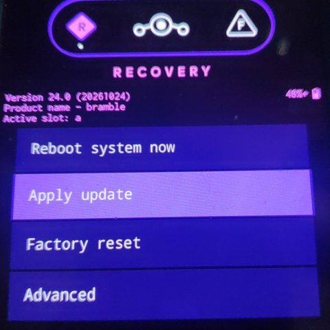
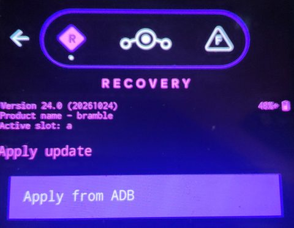
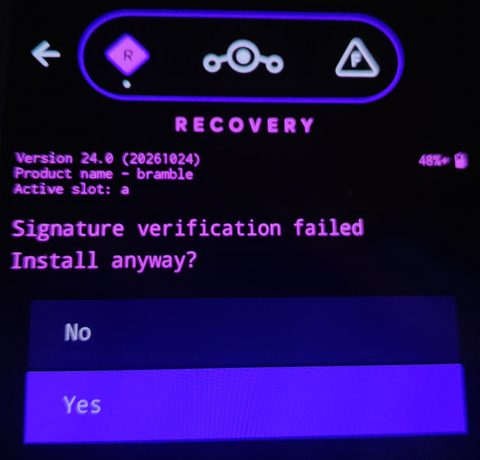
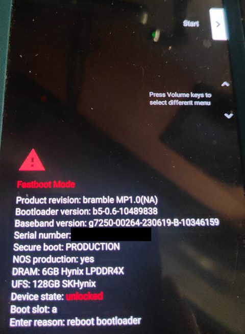
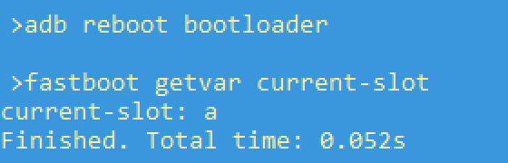
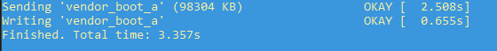
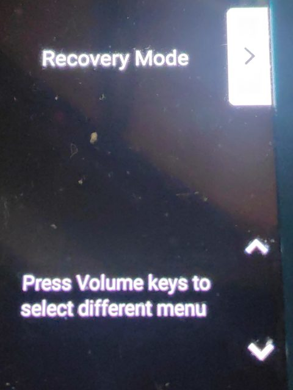
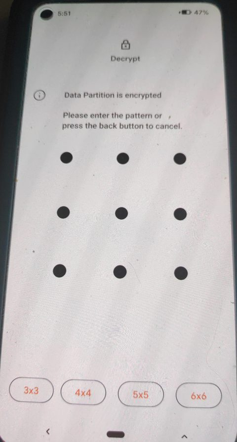
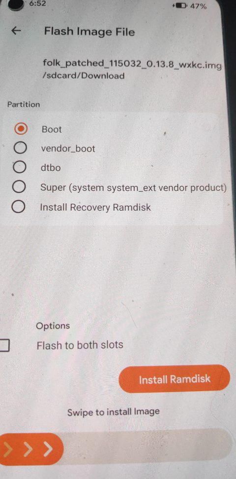
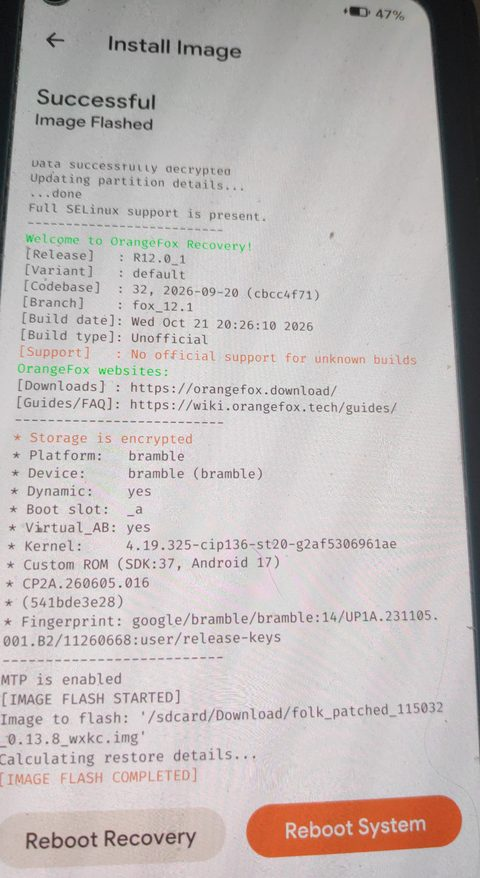

# bramble-orangefox

OrangeFox R12.0 (fox_12.1) for the Google Pixel 4a (5G), `bramble`, with `/data` decryption on
LineageOS 24.0 (Android 17). The device has no recovery partition, so OrangeFox is built into
`vendor_boot`. Images for LineageOS 23.2 (Android 16) are built from the
[`lineage-23.2`](../../tree/lineage-23.2) branch.

Tested build, test results and known gaps: [test-notes.md](test-notes.md). Every release carries
its own `TEST-NOTES.md`.

## What works

- Decryption of FBE v2 with metadata encryption: QTI keymaster 4.0 and gatekeeper through
  `qseecomd`, keystore2, and the lock screen credential through Titan M (Weaver)
- ADB, MTP, battery indicator, slot selection (QTI boot control 1.2)
- Backups: Boot, Data, Super, Vendor Boot and DTBO can be selected.
- USB-OTG: a USB stick or card reader is listed as USB-Storage on the Mount page and can hold
  backups. FAT32, exFAT and NTFS are mounted (NTFS through `ntfs-3g`). The phone has one USB-C
  port, so while a stick is attached there is no MTP or adb over USB; after removing the stick,
  turn MTP off and on. On the same device LineageOS mounts NTFS but not exFAT (its 4.19 kernel has
  no exFAT driver). FAT32 limits files to 4 GB.
- Normal Android boot from the same `vendor_boot`

## Read this before flashing

`vendor_boot` is not only the recovery here. Android's first stage boots from it too, and it
carries the kernel modules of one LineageOS build (`lib/modules`, 221 modules). Consequences:

- Use an image built for the LineageOS build you run. `patch-check.ps1` compares the security
  patch and the module version with the ROM's `boot.img` or OTA zip.
- A LineageOS OTA replaces `vendor_boot` and removes OrangeFox. Do not flash an older OrangeFox
  image after an update: if the kernel changed, the modules no longer load and Android may not
  boot. Wait for a matching release or build one.
- Keep a copy of your stock `vendor_boot` (see below) to go back.
- Do not use Fix Contexts or other functions that relabel `/data`. The recovery's Android 12
  SELinux library does not know the per-user levels of newer Android versions; this is why the
  automatic `restorecon` in vold was removed (see [patches/](patches/README.md)).

## Installing

1. Unlock the bootloader and keep the stock `vendor_boot` of your LineageOS build. Either extract
   it from the LineageOS zip (`payload.bin`, for example with payload-dumper-go), or copy it on
   the phone with `adb root` (userdebug builds) and
   `adb shell dd if=/dev/block/by-name/vendor_boot_a of=/sdcard/vendor_boot_a.img`
   (use your active slot).
2. Check the image: `patch-check.ps1 -BootImg <ROM boot.img> -RecoveryImg <OrangeFox .img>`.
   Flash it only if `RESULT` is a match and no `DECRYPT` line appears.
3. `fastboot flash vendor_boot_a <OrangeFox .img>` for the active slot, or install the `.zip` from a
   running OrangeFox (it writes `vendor_boot_a` and `vendor_boot_b`).
4. The bootloader does not accept `fastboot reboot recovery`; choose Recovery mode in the
   bootloader menu with the volume and power keys.

If `adb reboot` from a recovery that did not start completely brings you back to the recovery, the
misc partition still holds the recovery command. Clear it from a shell in the recovery:
`dd if=/dev/zero of=/dev/block/by-name/misc bs=2048 count=1`.

## Updating LineageOS

A LineageOS update is installed to the inactive slot and brings its own `vendor_boot`, so the new
slot starts without OrangeFox. The steps below put OrangeFox, add-ons and root back on the new
slot. They were written while updating the test device from lineage-24.0-20261017 on slot b to
lineage-24.0-20261024 on slot a; the pictures are from that update.

### Before installing: patch-check

The installed build is shown in Settings, System, Updater, or with root:

```
adb shell su -c "grep ro.lineage.version /product/etc/build.prop"
```

`getprop ro.lineage.version` may show a value changed by a spoofing module, and the `adb shell`
user cannot read the file without root.

```
powershell -ExecutionPolicy Bypass -File patch-check.ps1 -Zip <new LineageOS zip> -RecoveryImg <your OrangeFox .img | .zip>
```

| Line | Meaning for this update |
|---|---|
| `ROM INSTALL: Android starts` | The package writes its own `vendor_boot`, so the new slot starts Android and Lineage recovery. This is the normal case. |
| `RESULT: match` | Your OrangeFox image fits the new build's kernel and can be flashed to the new slot in step 6. |
| `RESULT: do not flash` | The kernel was rebuilt (23.2 to 24.0 was such a case). Wait for an OrangeFox image built for the new build. |
| `DECRYPT` line present | The new build has another security patch month or Android version. With a lower patch than the ROM, the image starts but does not unlock `/data`; with a higher one it can upgrade the key so that Android no longer unlocks it. Wait for an image built for the new build. |

A nightly from the same month as your image keeps its security patch, so only `RESULT` decides.
For lineage-24.0-20261024 and `v2026.10.22` the output was:

```
OTA metadata   : security patch 2026-10-01
Boot kernel    : 4.19.325-cip136-st20-g2af5306961ae, clang 22.0.2
OTA writes     : 21 partitions, including boot, dtbo, vendor_boot
Recovery props : Android 17.0.0, patch 2026-10-01 (vendor_boot v3)
Recovery kmods : 4.19.325-cip136-st20-g2af5306961ae, clang 22.0.2
RESULT: match, the kernel modules fit this ROM kernel
ROM INSTALL: Android starts. ...
```

For root (step 7) you also need the new build's unpatched `boot.img`: extract it from the zip's
`payload.bin`, for example with
[payload-dumper-go](https://github.com/ssut/payload-dumper-go):
`payload-dumper-go -p boot,vendor_boot <payload.bin>`. Keep both images; they are also the way
back if something does not start.

### Step 1: install the zip to the inactive slot

One of:

- **OrangeFox** (any update). Copy the zip to the phone, for example `adb push <zip> /sdcard/`
  (adb works in OrangeFox), then open the zip in the Files tab and swipe. OrangeFox prints
  `Flashing A/B zip to inactive slot` and at the end
  `To flash additional zips, please reboot recovery to switch to the updated slot.`
  It does not write itself to the new slot: on `vendor_boot` devices the "Reflash OrangeFox"
  option is not offered.
- **LineageOS Updater** (a nightly of the installed version). Settings, System, Updater. Do not
  use its "Reboot" button if you install add-ons; go to step 2 instead.
- **Lineage recovery with `adb sideload`** (a new version, as in the
  [LineageOS upgrade guide](https://wiki.lineageos.org/devices/bramble/upgrade/)). Flash the
  stock `vendor_boot` of the installed build to the running slot first, start its Lineage
  recovery, then Apply update, Apply from ADB, `adb sideload <zip>`.

Do not install add-ons in the same session: they would go to the slot that is still running.

### Step 2: start the new slot's Lineage recovery

The install made the new slot active, and its `vendor_boot` now holds Lineage recovery.

- From OrangeFox: Reboot, Recovery. Or from the computer: `adb reboot recovery`.
- From Android (after the Updater): `adb reboot recovery` with USB debugging on, or the power
  menu's Restart, Recovery if Advanced restart is enabled in Developer options.
- From the bootloader: volume keys to `Recovery Mode`, power key to confirm.



The header shows the new build and `Active slot`. Skip step 3 if you use no add-ons and choose
`Reboot system now`.

### Step 3: add-ons from Lineage recovery

Install microG, Google Apps or other add-on zips here, before the first boot. Android deletes the
data of a system app that is missing at first boot; the account and settings of a microG installed
later are gone (see below).

1. `Apply update`, then `Apply from ADB`. The phone waits for a sideload.

   

2. On the computer: `adb devices` lists the phone as `sideload`. Then
   `adb -d sideload <add-on zip>`. In this mode only `adb sideload` works; `adb shell` and
   `adb reboot` do not.
3. Add-on zips are not signed with the LineageOS key. At `Signature verification failed` choose
   `Yes` to install.

   

4. For another package choose `Apply from ADB` again. The arrow at the top left goes back to the
   main menu.

### Step 4: first boot

`Reboot system now`. The first boot of an update takes longer. Check the add-ons in Settings, Apps:
microG should be listed as microG Services, and its account should still be there.

If an add-on is missing, install its zip again from OrangeFox after step 6. On the test device
microG was missing on the new slot after the update of 2026-10-30; installed again from OrangeFox
after the first boot, it kept the Google account, and apps bought on Play Store still started.

### Step 5: bootloader and active slot

One of:

- `adb reboot bootloader` (Android with USB debugging, or OrangeFox)
- Power menu, Restart, Bootloader (with Advanced restart enabled)
- Phone off, then hold Volume down and Power



The screen shows `Boot slot`. From the computer:

```
fastboot getvar current-slot
```

It prints `current-slot: a` or `b`. Use that letter as `<slot>` below.



### Step 6: OrangeFox to the new slot

Flash only if patch-check reported `RESULT: match` and no `DECRYPT` line. The phone has no
recovery partition, so `fastboot flash recovery` does not work; OrangeFox goes to `vendor_boot`:

```
fastboot flash vendor_boot_<slot> <OrangeFox .img>
```



Then choose `Recovery Mode` with the volume keys and confirm with the power key. OrangeFox starts
and asks for the lock screen credential; it should unlock `/data`.

 

### Step 7: root, if you use it

Patch the new build's `boot.img` with your root manager. A boot image patched for an earlier build
carries that build's ramdisk; do not reuse it. The root manager app patches without root, so this
can be done on the new system after step 4: `adb push boot.img /sdcard/Download/`, patch, then
`adb pull /sdcard/Download/<patched img>` if you flash it with fastboot.

From OrangeFox (the order used on the test device: OrangeFox is checked first, then root):

1. Copy the patched image to the phone if it is not there: `adb push <patched img> /sdcard/Download/`.
2. Open the image in OrangeFox's Files tab. On `Flash Image File` select `Boot`, leave `Flash to both slots`
   unticked, and swipe. OrangeFox writes the active slot.

    

3. `Reboot System`.

From the bootloader instead: `fastboot flash boot_<slot> <patched img>`, then `Start`.

Both images can also be flashed in one fastboot session, one after the other:

```
fastboot flash vendor_boot_<slot> <OrangeFox .img>
fastboot flash boot_<slot> <patched boot.img>
```

If Android then does not start, the two cannot be told apart. Flash the unpatched boot first:
`fastboot flash boot_<slot> <unpatched boot.img>`. On this device root managers have been the
cause more often than OrangeFox.

### Merging the update

`boot` and `vendor_boot` are written outside the Virtual A/B snapshot, so steps 5 to 7 can follow
the first boot directly; an unfinished merge resumes when Android starts again. Before installing
another update or switching slots, wait until the merge has finished: on userdebug builds
`adb root`, then `adb shell ls /metadata/ota/snapshots` lists nothing.

### Why OrangeFox is not used before the first boot

Until the first boot the update is a compressed Virtual A/B snapshot that only `snapuserd` can
read, and OrangeFox (TWRP 12.1 base) does not run it: it shows the slot's previous system (Android
16 after installing 24.0 on the test device), and an add-on installed there is not part of the new
system. An OrangeFox image built for a newer Android version also unlocks the metadata layer as soon
as it starts and upgrades the key to that version.

After a new version or security patch has started, the other slot can no longer unlock `/data`:
keymaster does not give the upgraded key back to an older system. If the bootloader ever falls back
to that slot, it starts a system without access to your data. Install the update a second time to
bring the other slot to the same build, again with the add-ons before its first boot.

Google Apps packages are built for one Android version, so a new LineageOS version needs a new
package: for 24.0 (Android 17) the Android 17 package for arm64. The LineageOS guide asks for it
before the first boot of the new version, and allows adding or removing Google Apps only with a
factory reset.

On the test device the microG installer was not carried over by an update from 23.2-20261003 to
23.2-20261010, and the first boot ran without it. Android removes the data of a system package that
is gone after an update: after microG was installed again with `adb sideload`, the Google account
and the microG settings were gone, and an app's Play licence check returned `NOT_LICENSED` (561).
From 23.2-20261010 to 24.0-20261017 microG was installed from Lineage recovery before the first boot
of each slot, and the account stayed. Install add-ons before the first boot, for a nightly of the
same version too.

## Building

1. Sync OrangeFox `fox_12.1` (see the OrangeFox wiki) into `<OrangeFox source tree>`.
2. Clone this repository to `<OrangeFox source tree>/device/google/bramble`.
3. Apply the three patches in [patches/](patches/README.md) (`bootable/recovery`,
   `hardware/qcom-caf/bootctrl` and `system/vold`).
4. Optional: save the stock `vendor_boot` of your LineageOS build as
   `prebuilt/stock_vendor_boot.img`. OrangeFox then keeps its header and kernel command line and
   only replaces the ramdisk. Without it the image is built from this tree alone.
5. Build:

```bash
cd <OrangeFox source tree>
source build/envsetup.sh
export ALLOW_MISSING_DEPENDENCIES=true
for v in $(compgen -e | grep -E '^(OF_|FOX_)'); do unset "$v"; done
export TARGET_PRODUCT=twrp_bramble
source device/google/bramble/vendorsetup.sh
rm -f /tmp/bramble/fox_env.sh
lunch twrp_bramble-eng
touch bootable/recovery/orangefox.mk
mka adbd libminuitwrp mount.ntfs fsck.ntfs mkfs.ntfs libntfs-3g libfuse-lite
P=out/target/product/bramble
cp $P/system/lib64/{libminuitwrp,libntfs-3g,libfuse-lite}.so $P/recovery/root/system/lib64/
cp $P/system/bin/{mount,fsck,mkfs}.ntfs $P/recovery/root/system/bin/
rm -f $P/vendor_boot.img $P/ramdisk-recovery.img $P/ramdisk-recovery.cpio
mka vendorbootimage
```

Run the commands on separate lines: `source build/envsetup.sh` can return a non-zero status, so
a chain joined with `&&` stops after it.

The output is `out/target/product/bramble/OrangeFox-*-bramble.img` and `.zip`.

Why the extra lines:

- `vendorsetup.sh` exports its values only while `TARGET_PRODUCT` is `twrp_bramble`.
  `envsetup.sh` sources every `device/*/*/vendorsetup.sh` in alphabetical order, so in a source
  tree with other OrangeFox devices the last file would otherwise win.
- `lunch` writes the OrangeFox settings to `/tmp/bramble/fox_env.sh`, and the packaging step
  reads them from there; check that `FOX_BUILD_DEVICE` is `bramble` and
  `FOX_VENDOR_BOOT_RECOVERY` is `1` in that file. The values compiled into the recovery come
  from `bootable/recovery/orangefox.mk`, which Kati only re-reads when a makefile changes, hence
  the `touch`.
- `libminuitwrp.so` is copied into the ramdisk by a post-install command that does not run
  again in an incremental build. Since the colour change in `patches/bootable_recovery.diff`,
  the `recovery` binary needs the new library (`res_swap_red_blue`); an old copy keeps the
  recovery from starting. `recovery-inspect.ps1` checks this in its Display group. The NTFS tools
  (`TW_INCLUDE_NTFS_3G`: `mount.ntfs`, `fsck.ntfs`, `mkfs.ntfs`, `libntfs-3g.so`,
  `libfuse-lite.so`) reach the ramdisk the same way and are copied by hand too.
- The theme is copied into `recovery/root/twres`, but the ramdisk does not depend on those
  files: after a change to theme files only, `mka vendorbootimage` keeps the old image. Deleting
  `vendor_boot.img`, `ramdisk-recovery.img` and `ramdisk-recovery.cpio` makes it rebuild them.

`BOARD_AVB_ENABLE := true` in `BoardConfig.mk` is needed for the OrangeFox packaging step: in
fox_12.1 `build/make/core/Makefile` calls it only in the AVB branch of the `vendor_boot` rule.

### Updating for a new LineageOS build

Take `Image.lz4` and the DTB from the new `boot.img`, `dtbo.img`, and `first_stage_ramdisk` and
`lib/modules` from the new `vendor_boot.img`, then update `PLATFORM_SECURITY_PATCH` and
`VENDOR_SECURITY_PATCH` in `BoardConfig.mk` (and `PLATFORM_VERSION` for a new Android version). A
recovery with a lower patch level than the ROM fails with keymaster error -38; a higher one may
upgrade the metadata key so that the ROM can no longer unlock `/data`.

The Titan M services keep their Android 16 runtime (`recovery/root/system/lib64/a16` and
`linker64_a16`) on LineageOS 24.0. It belongs to the vendor files in `recovery/root`, which come
from the 2023 vendor image, not to the ROM. The Android 17 `libbinder_ndk` needs `libbinder`
symbols that this vendor `libbinder.so` does not have.

## Other ROMs

A released image is built for one LineageOS build. It carries that build's kernel modules and
reports its security patch, so it is not a general Pixel 4a (5G) recovery:

- On a ROM with a different kernel the modules do not load, and because `vendor_boot` is also
  used for the Android boot, Android may not start either. `patch-check.ps1` prints the module
  version next to the ROM kernel; flash only when it reports a match.
- If the ROM's security patch differs, keymaster refuses the metadata key (lower patch) or
  upgrades it (higher patch).

Supporting another ROM means rebuilding this tree with that ROM's images, as described in
"Updating for a new LineageOS build". The decryption chain uses the QTI keymaster 4.0, gatekeeper
and Titan M files from the vendor image with fingerprint
`google/bramble/bramble:14/UP1A.231105.001.B2`. A ROM that ships the same vendor image and the
same encryption settings (FBE v2 with metadata encryption) needs only the kernel, modules, DTB,
dtbo and patch values replaced. A ROM with a different vendor image may need the files in
`recovery/root` replaced as well; `recovery-inspect.ps1` lists them.

If you build and test this tree on another ROM, please open an issue with the ROM name and
build, the `patch-check.ps1` output and `/tmp/recovery.log`.

## Tools

### patch-check.ps1

Checks whether a recovery image fits a ROM build before you flash it. `-RecoveryImg` takes the
OrangeFox `.img` or `.zip`. For a `vendor_boot` image the script prints up to three verdicts:

- `RESULT`: the version of the kernel modules in the image against the ROM kernel. Flash only on
  a match; with other modules Android may not start.
- `DECRYPT`: printed when the image and the ROM report different security patch levels. With a
  lower level keymaster refuses the metadata key and `/data` stays encrypted; on this device it
  returned -62 and then -38, and the key was not changed. With a higher level keymaster can
  upgrade the key, and the ROM can then no longer unlock `/data`.
- `ROM INSTALL` (with `-Zip`): whether the ROM package writes `vendor_boot`, read from the
  `payload.bin` manifest. The LineageOS Updater and OrangeFox both install the package to the
  inactive slot, and this OrangeFox build does not write itself back afterwards
  (`OF_NO_REFLASH_CURRENT_ORANGEFOX` is set for header v3 `vendor_boot` builds), so a package
  that carries `vendor_boot` leaves the new slot with the ROM's own image.

For a `recovery.img` (the other devices that share this script) the verdict comes from the image
header and from the `/data` line of the ROM's and the recovery's fstab, printed as `ROM fstab` and
`Recovery fstab`: a recovery whose fscrypt version differs from the ROM's cannot decrypt `/data`.
These two lines are read from header v0-v2 images and do not appear for bramble, whose fstab is in
`vendor_boot`.
Works in Windows PowerShell 5.1 and PowerShell 7. Extracting `boot.img` from an A/B package
(`payload.bin`) needs [payload-dumper-go](https://github.com/ssut/payload-dumper-go) or the
`payload_dumper` bundled with Multi Image Kitchen.

```
powershell -ExecutionPolicy Bypass -File patch-check.ps1 -BootImg <boot.img> -RecoveryImg <OrangeFox .img | .zip>
powershell -ExecutionPolicy Bypass -File patch-check.ps1 -Zip <ota.zip> -RecoveryImg <OrangeFox .img | .zip>
```

Example output (lineage-24.0-20261017 and the image built for it):

```
OTA device     : bramble
OTA metadata   : security patch 2026-10-01
Boot header    : Android 17.0.0, patch 2026-10 (header v3)
Boot kernel    : 4.19.325-cip136-st20-g2af5306961ae, clang 22.0.2
OTA writes     : 21 partitions, including boot, dtbo, vendor_boot
Recovery props : Android 17.0.0, patch 2026-10-01 (vendor_boot v3)
Recovery kmods : 4.19.325-cip136-st20-g2af5306961ae, clang 22.0.2
Recovery device: bramble
RESULT: match, the kernel modules fit this ROM kernel
ROM INSTALL: Android starts. The package writes its own vendor_boot to the inactive slot, ...
```

### recovery-inspect.ps1

Lists what an OrangeFox image contains. The same script is used for every device of
Gursu-Bilisim; it reads the device from the image and runs that device's checks. For bramble:
first stage files and modules, the QTI decryption chain, the Titan M services with their
Android 16 runtime, boot control, display library and USB. Accepts the `.img` or the OrangeFox
`.zip`.

```
powershell -ExecutionPolicy Bypass -File recovery-inspect.ps1 -Img <OrangeFox .img | .zip>
```

### release.sh

Publishes the latest build as a GitHub release: image, zip, both scripts, `TEST-NOTES.md` and
`SHA256SUMS`. It stops if `test-notes.md` is older than the image or does not name its SHA-256,
if `bootable/recovery`, `hardware/qcom-caf/bootctrl` or `system/vold` no longer match the diffs in
`patches/`, or if the device tree has uncommitted changes or a commit that is not on GitHub; the
release tag is created on that commit. `./release.sh r2` adds a suffix
for a second release on the same day; `FOX_TREE=<OrangeFox source tree> ./release.sh` if the build
is not three folders above the device tree.

## Credits and license

Built with the work of TeamWin, OrangeFox, LineageOS and the sources listed in [NOTICE](NOTICE).

- Files written for this repository: Apache License 2.0 ([LICENSE](LICENSE)).
- Changes to OrangeFox/TWRP: GPL-3.0-or-later; changes to TeamWin `android_system_vold`: Apache
  License 2.0. Both in [patches/](patches/).
- Prebuilt Google, Qualcomm and STMicroelectronics vendor files: not covered by either license.

If you reuse parts of this tree, keep the NOTICE file and credit the sources it lists.
